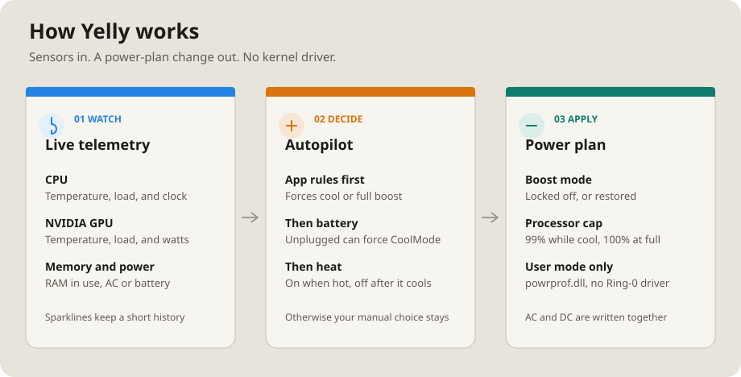
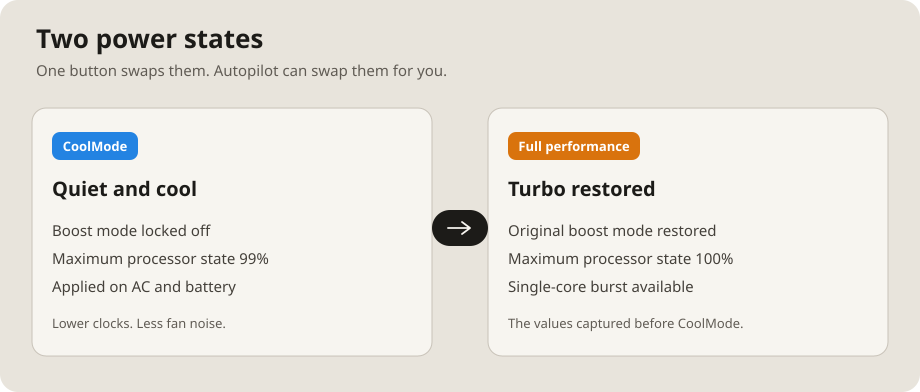
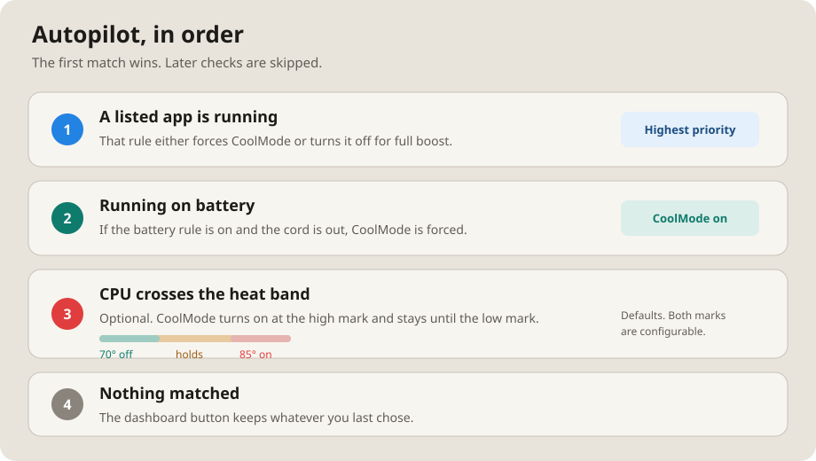
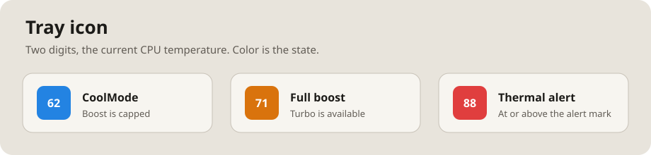

# Yelly

<p align="center">
  
</p>

A zero-dependency, lightweight Windows desktop & system tray utility that replicates the core functionality of **Outbyte Camomile**'s "CoolMode" and live temperature monitoring without bloat, kernel drivers, telemetry, or background services.

Includes a desktop dashboard, live hardware telemetry with sparklines, and an Autopilot engine that can switch power states for you.

## At a glance

<p align="center">
  
</p>

<p align="center">
  
</p>

<p align="center">
  
</p>

<p align="center">
  
</p>

## Features

- **Branded & Notion-Themed UI**:
  - Distinctive Yelly branding, custom window controls, and a warm stone light theme.
  - Interactive navigation: **Dashboard**, **Autopilot**, and **Settings**.
  - One-click hero action card to instantly toggle CoolMode.

- **Real-Time Hardware Telemetry**:
  - **CPU**: Thermal zone temperature (°C / °F), utility load percentage, clock frequency (GHz), and live sparkline.
  - **GPU**: NVIDIA RTX/GTX temperature, GPU core utilization, power draw (W), and VRAM usage via non-blocking background streaming.
  - **Memory & Power**: Physical RAM committed/total, battery charging status, battery percentage, and AC line detection.

- **Autopilot Automation Engine**:
  - Process-specific rules: Automatically disables CoolMode when high-performance apps (e.g. `cyberpunk2077.exe`, `blender.exe`) are launched, and re-engages CoolMode when closed.
  - Battery awareness: Automatically forces CoolMode when running on battery power to maximize endurance.
  - Thermal trigger: Optional automatic CoolMode engagement when temperatures exceed configurable threshold (with hysteresis).

- **System Tray Integration**:
  - Live 2-digit temperature rendering directly inside the system tray icon (blue = CoolMode, amber = full performance, red = thermal alert).
  - Quick-action context menu with live temps, toggle shortcut, dashboard launcher, and startup toggle.

- **Zero External Dependencies**:
  - Written in pure C# using Windows .NET 4.x WinForms and GDI+. Embedded Win32 `.ico` and in-app logo resource. Compiles directly with Windows' built-in `csc.exe` in under 2 seconds.

## Building & Packaging

- **Compile standalone executable**:
  Run [build.bat](file:///d:/Code/Projects/yely%20by%20jj/build.bat) or compile with Windows' built-in C# compiler:
  ```cmd
  C:\Windows\Microsoft.NET\Framework64\v4.0.30319\csc.exe /target:winexe /optimize+ /win32icon:Yelly.ico /resource:Yelly.png /out:Yelly.exe Ui.cs Settings.cs Telemetry.cs Autopilot.cs MainForm.cs Yelly.cs
  ```

- **Package into Windows installer**:
  Run [package.bat](file:///d:/Code/Projects/yely%20by%20jj/package.bat) to build `dist\YellySetup.exe` with Inno Setup.

